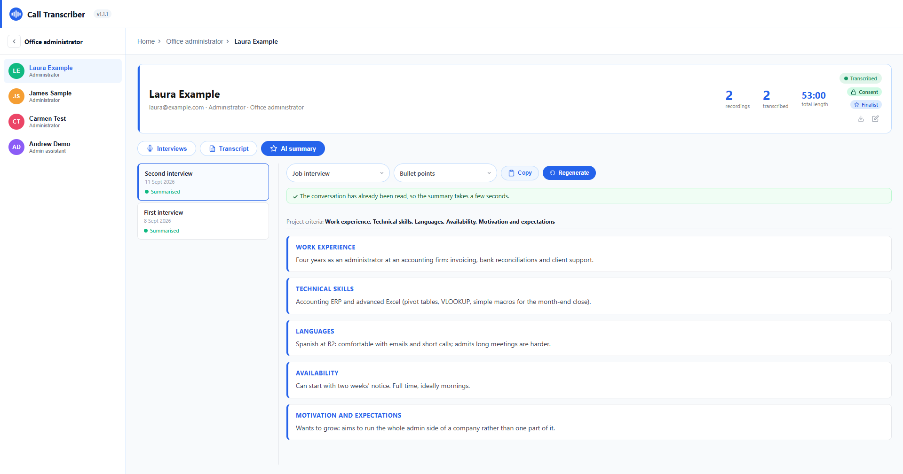
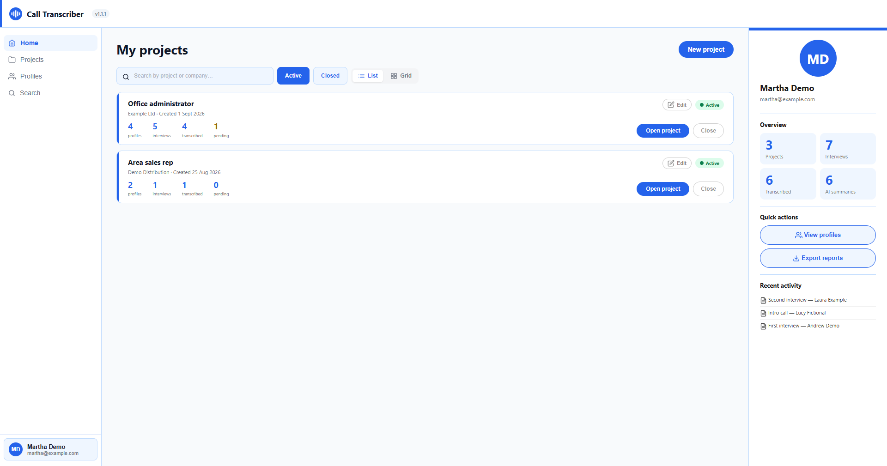
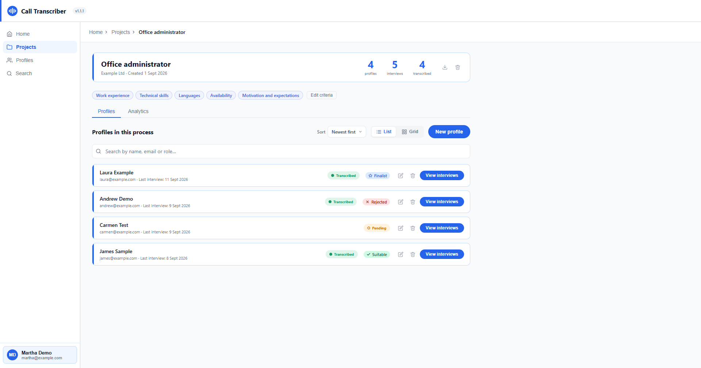
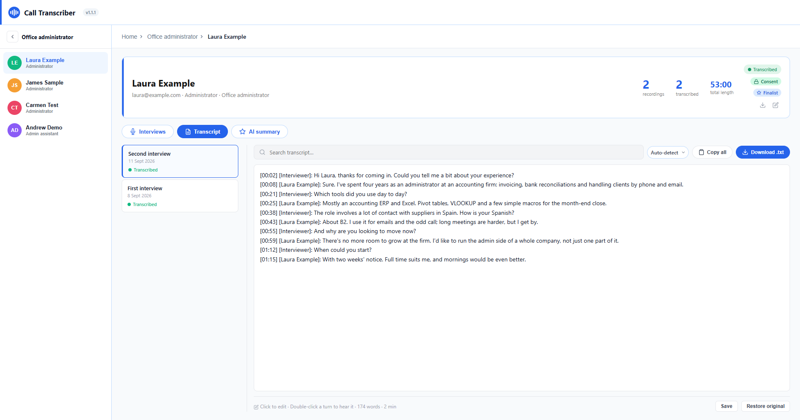

# Call Transcriber

**English** · [Español](README.es.md)

Record, transcribe and summarise job interviews with AI. A Windows desktop app that
captures your microphone **and** the video call audio, works out who said what,
transcribes it and writes an evaluation summary.

**Your data stays on your computer.** There's no server of ours, no required account and
no subscription. You bring your own key for an AI service (Groq is free and doesn't ask
for a card) and that's it.

> **Windows 10/11 only.** System audio capture uses `loopback`, which in practice is a
> Windows feature. It builds on macOS and Linux, but it won't record.



<details>
<summary>More screenshots</summary>

**Home:** active projects and recent activity.


**A project:** evaluation criteria and the status of each profile.


**Transcript:** split by speaker, timestamped and editable.


</details>

*All names and data in the screenshots are made up.*

---

## What it does

- **Records microphone + system audio at the same time**, or microphone only. Optionally,
  video of the screen or of a specific window.
- **Separates speakers**: it uses the other person's clean audio track to tell which voice
  is theirs, instead of guessing from pauses.
- **Transcribes** with the service of your choice and lets you edit the text by hand.
- **Summarises** in two formats — bullet points by section or a narrative write-up — and
  for two contexts: job interview or business meeting. **The summary is written in the
  language of the interview**: an interview held in Spanish gets a Spanish report, even if
  the app is in English.
- **English and Spanish interface.** It starts in your Windows language, and you can change
  it in *Settings → General*.
- **Organises** everything into projects, candidates and interviews, with evaluation
  criteria and interviewers per project.
- **Candidate consent** (GDPR): a checkbox, a warning before recording, and data export and
  deletion.
- **Exports to PDF**.

## Installation

1. Download the installer from the [latest release](https://github.com/Vankish/Call-transcriber/releases/latest)
   (`Call-Transcriber-Setup-X.Y.Z.exe`).
2. Run it. **Windows will warn you that the publisher is unknown**: click
   `More info` → `Run anyway`.

   It isn't a bug or a real threat: that warning only goes away with a code signing
   certificate (€200–400 a year), which this project doesn't have. For the same reason,
   **the app doesn't update itself**: it tells you when a new version is out and opens this
   page so you can download the installer.

3. Open it. You go straight in, with no account or sign-up.
4. It will ask for an **AI API key**. Groq's is free and doesn't ask for a card:
   [console.groq.com](https://console.groq.com) → *API Keys* → create one → paste it.

That's all. The key is stored only on your computer and is never sent anywhere except the
AI provider you picked.

## Which AI service to use

The app isn't tied to any provider: it speaks the most common API dialects, and you can
switch services in **Settings → AI engines** without touching anything else.

| Service | For | Notes |
|---|---|---|
| **Groq** | Transcription and summaries | Free, no card. The easiest way to start. |
| **ElevenLabs (Scribe)** | Transcription | The best at Spanish and at separating speakers. Paid beyond the free quota. |
| **OpenAI** | Transcription and summaries | |
| **Deepgram** | Transcription | |
| **Anthropic (Claude)** | Summaries | |
| **Other (custom)** | Both | Enter the URL yourself: your own server, a local model, anything. |

Services marked **"untested"** in the app have their adapter written, but nobody has run
them against the real API yet.

## Sync between computers and share folders *(optional)*

Without an account, everything lives on this computer. If you want to open your interviews
from another computer or give a colleague access, you need a database, and **each user
brings their own** — so your data is yours and nobody hosts it for you. Supabase's free
plan is enough for about 15 interviews with audio.

This **isn't included in the installer**: the published `.exe` is local-only on purpose.
To get the cloud features you have to build your own copy:

```bash
git clone https://github.com/Vankish/Call-transcriber.git
cd Call-transcriber
npm install
```

1. Create a free project at [supabase.com](https://supabase.com).
2. In its **SQL Editor** → *New query*, paste the whole of
   [`supabase/setup.sql`](supabase/setup.sql) and click **Run**. It creates the tables,
   the permissions and the audio storage in one go.
3. Copy `.env.example` to `.env` and fill it in with the values from your project's
   **Project Settings → API**:

   ```
   VITE_SUPABASE_URL=https://YOUR_PROJECT.supabase.co
   VITE_SUPABASE_ANON_KEY=YOUR_PUBLISHABLE_KEY
   ```

4. `npm run package:win:personal` builds your installer into `release/`. Careful: plain
   `package:win` **won't work** for this, because it deliberately builds with placeholder
   credentials (it's the one that gets published, and it mustn't carry anyone's keys).

After that, the sign-up form appears on the start screen. When you create your account,
anything you already had locally is uploaded automatically.

**Free plan limits:** 1 GB of files and 50 MB per file. A one-hour mp3 (~32 MB) fits; a
two-hour one doesn't. **Video is never uploaded**: it's about 300 MB per interview and two
of them would fill the gigabyte.

## Privacy

You're recording people during a hiring process, so it's worth knowing exactly where their
data goes:

- **The audio recording** leaves your computer for the transcription provider you chose.
  All the providers included by default have their servers in the **United States**.
- **The interview text** goes to the summary provider.
- **Video** never leaves your computer.
- **Your AI keys** are stored only in the installation's local `config.json`.
- If you enable the cloud, the data and audio you upload go to **your own** Supabase
  project.

[`legal/`](legal/) contains drafts of a privacy policy, a candidate consent form, a data
processing agreement (DPA) and a retention policy. **They are in Spanish, written with
Spanish and EU law in mind, and they're drafts: have a lawyer review them** before using
them for real.

## Development

```bash
npm install
npm run desktop:dev     # desktop app with hot reload
npm run build           # tsc + vite → dist/
npm run package:win     # build + NSIS installer into release/
npm run lint
npm run i18n:check      # make sure no string is missing its English translation
```

⚠️ `electron-builder` **doesn't compile anything**: it packages whatever is in `dist/`. If
you run it without `npm run build` first, you'll rebuild the `.exe` with the old code.

**Interface text.** Strings are written in Spanish inside `t('...')`, and the English
translation goes in `src/i18n.ts` (or in `electron/i18n.cjs`, with `tr('...')`, when the
text comes from the main process). `npm run i18n:check` flags any that are missing. The code
comments are in Spanish too.

More project context in [`CLAUDE.md`](CLAUDE.md) (in Spanish).

## License

[MIT](LICENSE).
